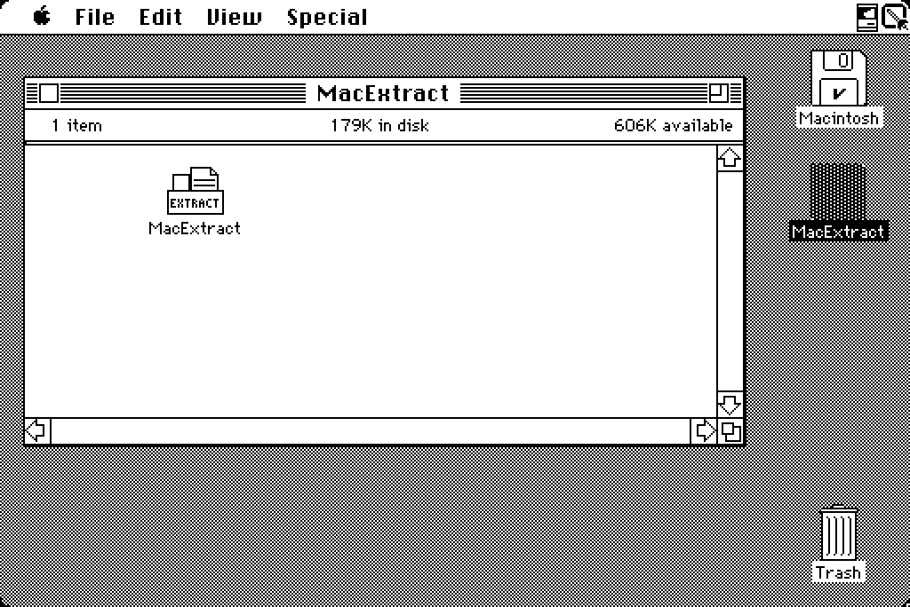

# MacExtract

**Open old Macintosh archives — on the Macintosh they came from.**

A `.sit` file from 1995 is easy to open on a modern machine and surprisingly
hard to open on the machine it was made for. `macextract` is an unarchiver for
Classic Mac OS that runs on everything from a 1986 Mac Plus with 1 MB of RAM
up to Mac OS 9 — one application, no extensions, no installer. There is a
Linux command-line version too, built from the same engine.

## What it looks like

One 180K application on an 800K floppy, an open carton lettered EXTRACT, drawn
for 1-bit, 16-colour and 256-colour screens:



Pick an archive, then say where the files go — the archive's own folder is
the default, so Return means "next to it", and any other disk is a Drive click
away. On System 7 and later you can skip the first step and **drop the archive
on the application's icon** — any file, whatever type it claims to be:


Watch it work — with a real estimate, because on a Mac Plus some archives take
twenty minutes. Change your mind at any point; anything half-written is
cleaned up:


If anything had to change on the way — a name HFS cannot keep (31 characters
max), two files or two folders whose names are the same for those 31
characters, an entry that would not come out — you are told which. Nothing is
overwritten and nothing is folded together: the second one gets a `~1`.
**Save as Text** files the whole list as a document:


If an archive was split across floppies and a part is not where the first one
was, you are asked for it — and told straight away if you point at the wrong
one, because parts are recognised by what is inside them:


## Download

**[Latest release](https://github.com/jarreboum/MacExtract/releases/latest)** —
currently **v0.37.0**. Or take it straight from the tree:

| | |
|---|---|
| [`dist/MacExtract.bin`](dist/MacExtract.bin) | the application as uncompressed MacBinary — transfer it with anything MacBinary-aware |
| [`dist/MacExtract.dsk`](dist/MacExtract.dsk) | an 800K HFS floppy image — write it to a real floppy, or mount it in Mini vMac, Basilisk II or SheepShaver |

Neither needs an unarchiver to open, which is the point: a bare Mac has no way
to unpack a `.sit` until it already has something that can.
[`dist/README.txt`](dist/README.txt) has the transfer notes.

## What it opens

**Extracts:** StuffIt (`.sit`, classic and 5.x), Compact Pro (`.cpt`), BinHex
(`.hqx`), MacBinary, PackIt (`.pit`), AppleLink packages (`.pkg`),
DiskDoubler (`.dd`, `DDAR`, `DDA2`), Now
Compress, StuffIt SpaceSaver, Alysis SuperDisk! (`.X`), ARC (`.arc`), LZH /
LHA (`.lzh`, `.lha`, including the ones MacLHA wrote), uuencoded files
(`.uu`), btoa (`.ascii`), base64 and MIME mail attachments (`.b64`, `.mim`),
AppleSingle/AppleDouble, zip, gzip, tar and Unix compress (`.Z`). Resource
forks, type and creator codes and dates all survive, so an extracted
application simply runs. A zip made by PKZIP 1 in 1989 or 1990 opens too —
those use a method nothing has written since — and a zip ZipIt made comes
out under the names the Macintosh files actually had, not the shortened
MS-DOS ones it may have put in the listing.

Nested files like `.sit.hqx` or `.tar.Z` are unwrapped automatically, by
looking inside them rather than trusting the name — and a `.hqx` or `.uu`
holding several files, or one posted in several parts, gives you all of it.
**Self-extracting archives are opened as archives** — the Macintosh ones,
including ZipIt's, which are a PowerPC application with a zip hidden behind
it. You get the files, on a Mac that could never have run the application.
(A self-extracting `.exe` from the PC side is not recognised unless what is
behind it is a zip.)
SpaceSaver files are the odd ones: they look like ordinary documents, because
SpaceSaver compressed them in place and only the Mac that made one could read
it. `macextract` carries the table those files need, so a lone floppy is
enough.

**Password-protected archives** are opened too — StuffIt, StuffIt 5, Compact
Pro, PackIt, zip (the old cipher and WinZip's AES) and ARC. The Mac
application asks when it reaches an entry that needs one; on Linux it is `-p`.
One catch, and it is the format's rather than ours: an encrypted StuffIt
archive keeps half its key in the file's resource fork, so a copy that lost
the fork cannot be opened by anything.

**Archives split across floppies** are joined for you: StuffIt, Compact Pro
and DiskDoubler `SPLT` sets, spanned zip (`.z01` … `.zip`), plain `.001`/`.002`
splits, parts still wrapped individually (`Archive.sit.1.hqx`), and a file
that arrived as several mail messages. Open the first part and the rest are
found beside it; if one is elsewhere you are asked to point at it, and putting
the disk in is enough. Mac-format and mailed sets are recognised by what is
inside them, so names do not matter; for zip and `.NNN` sets the names are all
there is, so keep them. Send the output to a different disk from the parts —
the only thing that works when you are swapping floppies.

**Recognises but does not extract:** StuffIt X and the PC-side and modern
archives — RAR, 7-Zip, xz, bzip2, Zstandard, lzip, lrzip, Cabinet, WIM, Zoo,
ARJ, cpio, `ar`/`.deb` and Apple Archive (`.aar`). You get *"MacExtract
cannot open RAR files."*, not something that looks like a damaged download.

## Compared with what Aladdin sold

Three yardsticks, one per machine you might be sitting at. **StuffIt Expander
4.0.2** (1996) is the free one, and the newest StuffIt that still runs on
System 6. **StuffIt Deluxe 5.5.1** (1999) is the high-water mark for a 68k
Mac: Aladdin dropped 68k support at 6.0 and said so — *"For users of 68K Macs
that wish to have StuffIt technology, simply download any 5.5 version"* — and
5.5 reads more Macintosh formats than any StuffIt before or after it.
**StuffIt Deluxe 7.0.3 Classic** (2003) is the last one for Mac OS 9, and it
is PowerPC-only, so no 68k Mac runs it at all.

| | Expander 4.0.2 (free, System 6) | Deluxe 5.5.1 (paid, last for 68k) | Deluxe 7.0.3 Classic (paid, last for Mac OS 9) | MacExtract |
|---|---|---|---|---|
| Oldest Mac it runs on | System 6.0.5 | System 7.5.3, 68020 | Mac OS 8.6, PowerPC, 32 MB | System 3.0, 68000, 512 KB |
| StuffIt, Compact Pro, BinHex, MacBinary | ✅ | ✅ | ✅ | ✅* |
| StuffIt 5 archives | 🔴 | ✅ | ✅ | ✅ |
| StuffIt X (`.sitx`) | 🔴 | 🔴 | ✅ | 🔴 |
| zip, gzip, tar, `.Z`, `.arc`, `.uu` | ✅ with the paid add-on | ✅ | ✅ | ✅ |
| Type and creator in a zip made by MacZip | 🔴 ** | 🔴 ** | 🔴 ** | ✅ |
| StuffIt SpaceSaver | ✅ with the add-on | ✅ | 🔴 | ✅ |
| PackIt (`.pit`) | 🔴 | ✅ | 🔴 | ✅ |
| AppleLink packages (`.pkg`) | ✅ with the add-on | ✅ | 🔴 | ✅ |
| `.lzh` / `.lha` | 🔴 | ✅ | ✅ | ✅ |
| DiskDoubler (`.dd`) | 🔴 | ✅ | 🔴 | ✅ |
| Now Compress and Alysis SuperDisk! | 🔴 | 🔴 | 🔴 | ✅ |
| RAR, ARJ and bzip2 | 🔴 | ✅ bzip2 only | ✅ | 🔴 |
| Private File (`.pf`) and self-mounting disk images | 🔴 | ✅ | ✅ | 🔴 |
| A Mac file mailed as a MIME attachment | 🔴 | ✅ | ✅ | ✅ |
| StuffIt sets split across floppies | ✅ with the add-on | ✅ | ✅ | ✅ |
| Compact Pro, zip or `.001` sets split across floppies | 🔴 | 🔴 | 🔴 | ✅ |
| An archive that arrived as several mail messages | 🔴 | 🔴 | 🔴 | ✅ |
| Encrypted StuffIt archives | ✅ | ✅ | ✅ | ✅ |
| Anything StuffIt Deluxe 2.0 itself wrote — its five Optimizers, all five of its ciphers | 🔴 | not tested here | not tested here | ✅*** |
| Encrypted Compact Pro archives | 🔴 | 🔴 | 🔴 | ✅ |
| The note somebody typed into an archive | ✅ | ✅ | ✅ | ✅ |
| What you install | an application, an extension and the add-on | an installer, seven applications, the StuffIt Engine, Magic Menu and seventeen translators | an installer, twelve applications, CarbonLib and twenty-three format plug-ins | one application |
| Source | free, closed | paid, closed | paid, closed | free, open (LGPL) |

\*\* **A zip made by MacZip — the Macintosh port of Info-ZIP's `zip` —
carries the Finder's type and creator, and StuffIt throws them away.** The StuffIt on hand here — Expander
3.5.2 with UnZip Translator 3.5, 1994 — works them out from the
filename instead, off a built-in table of nineteen extensions: `.TXT`
becomes `TEXT/ttxt`, `.DOC` becomes `TEXT/MSWD`, and anything it does
not recognise becomes `TEXT/ttxt` too. Over the Rex Nebular archive on
Macintosh Garden, whose uploader used MacZip, three files that should
come back `TEXT/MSWD` come back `TEXT/ttxt`. There is no `.dsk` row in
that table either, which is why the nine disk images in it lose the
`DDim/DDp+` that tells DiskCopy what they are. It also quietly
converts line endings, so a text file is 720 bytes where the archive
holds 739. MacExtract reads what the archive actually stored.

The other three 🔴 are read out of the code rather than run. **Deluxe
5.5.1 and 7.0.3 both came out after the field was published**, so being
newer was the thing worth checking — and both do it the same way 3.5.2
does. 5.5's zip reader has no table of its own; the engine behind it
carries one of 234 extensions. 7.0.3's is a separate PowerPC plug-in.
Neither contains the two bytes that identify the field anywhere a
comparison could use them, and a comparison is exactly where those
bytes would have to appear. Expander 4.0.2's 🔴 is a different fact
again: on its own it cannot open a zip at all, so it has nothing to
preserve. Only 3.5.2 was actually run over an archive.

\*** **The bar is what StuffIt Deluxe 2.0 writes with what was in its
box** — the five Optimizers, the two ciphers built into the
application, the two encryptor modules on its optional disk, and
`PassLock`, which turns out to encipher nothing at all. Every one of
them is undone here, each graded against an archive 2.0.1 itself wrote
under an emulator. A *third party's* compression plug-in is outside
that bar: none shipped in the box, this project has never seen one, and
if any exist the files will have to come from somebody who has them.
The 🔴 is 2.0's own Engine, which refuses an entry its Optimizers
touched — *"Please use StuffIt Deluxe instead"* — and what the two
later Deluxes do with these archives has not been measured here.

\* **One rare kind of StuffIt entry comes back changed, and MacExtract
says so.** StuffIt Deluxe 2.0 (1990) could run a small plug-in called an
*Optimizer* over a file before compressing it, and no StuffIt since has
opened those archives. MacExtract opens **all five** Aladdin shipped. A
file `Sound 1` or `Photoshop 1` touched comes back byte for byte. One
`Text 1` touched comes back tidied — which is what StuffIt Deluxe hands
back too, since the plug-in threw the rest away. A painting `MacPaint 1`
touched comes back with the picture intact and a blank header, and a
photograph the `JPEG Lossy` one touched comes back softened: both lost
something before the archive was ever written, and nothing can bring it
back. Whenever a file is not exactly the one that was archived,
MacExtract tells you which file and why.

**Speed is a wash.** Both were booted on the same 7 MHz Mac Plus, handed the
same archives on the same disk, and timed by the same instrument:

| Archive | MacExtract | Expander 4.0.2 |
|---|---|---|
| A few KB of StuffIt | 3 seconds | 3 seconds — too quick to tell apart |
| 280 KB StuffIt | 1 minute | 1 minute — level |
| 250 KB Compact Pro | **2¼ minutes** | 2½ minutes |
| 300 KB BinHex with a StuffIt archive inside | **4½ minutes** | 7 minutes |

Choosing between them on speed alone gives you nothing to choose by. Times are
to the nearest few seconds, and both wrote the same files — which is what makes
them comparable at all. Expander 4.0.2 is the only one that could be timed: 5.5.1
needs a 68020 and 7.0.3 a PowerPC, so neither will run on the Mac Plus these
figures are taken on. The full capability table and the unrounded figures are
in [FORMATS.md](FORMATS.md), under "Compared with StuffIt Expander 4.0.2",
"The paid box", "The last classic box" and "Timed on the same Mac Plus" inside
it.

## What you need, and how long you will wait

| | |
|---|---|
| Minimum | System 3.0, 68000, **512 KB of RAM** — a Macintosh 512Ke, or a Plus with the system it shipped with in January 1986. A 64K-ROM Macintosh (the 128K and the true 512K) is out: this download bombs there, and the experimental build that does start is on the `rom64k` branch |
| For everything | **1 MB** — see the StuffIt 5 note below |
| Also runs on | System 6, System 7, Mac OS 8 and 9, PowerPC via the built-in 68k emulator |
| Disk | one 800K floppy |

**StuffIt 5 on a 512 KB machine.** A `.sit` written by StuffIt 5 is
compressed in blocks, and the whole block has to be in memory to unpack it.
Small ones are fine — half the StuffIt 5 archives tested fit in 512 KB — but a
big block will not, and there is nothing the application can do about it: the
size was chosen when the archive was made, on a machine with memory to spare.
Those entries are skipped with a message and the rest of the archive still
comes out. Every other format tested fits in 512 KB. With 1 MB the question
does not arise.

On System 3.0 the Open dialog does not close on Command-period — that system's
Standard File ignores it. Click Cancel instead. System 6 and later are
unaffected, and Command-period stops an extraction on every system.

The same binary adapts to whatever machine it finds itself on, so the download
above is the only one. On a 1 MB Mac Plus, the slowest machine supported:

| Archive | Time |
|---|---|
| A few KB, any format | seconds |
| 300 KB StuffIt or BinHex | 2–3 minutes |
| 200 KB StuffIt 5 | 13 minutes |
| 640 KB StuffIt 5, worst case measured | 21 minutes |

StuffIt 5 is in a class of its own — its compression was designed for machines
a decade newer. Everything else is quick, and a faster Mac is proportionally
faster.

**Memory** only matters under MultiFinder or System 7, where the application
gets the size set in its Get Info window. It asks for 4 MB, runs in as little
as 400 KB, and **at about 850 KB every archive in the test sample comes out
whole**. Below that, entries too big to fit are named one by one and the rest
extract.

## Linux

```sh
make
build/macextract l archive.sit           # list
build/macextract x archive.sit -o out    # extract
build/macextract x archive.sit -o out --only "Read Me"   # just that one
build/macextract sniff mystery.bin       # what is this?
build/macextract x secret.sit -p hunter2 # password-protected
```

## Is it any good?

It is checked against [The Unarchiver](https://theunarchiver.com/) on 932 real
archives, byte for byte, both forks. The Macintosh application is checked the
same way *while running on* an emulated Mac Plus, a System 7 machine and a
Mac OS 9 machine — not only on Linux.

No physical Macintosh has ever run it. Emulation is evidence, not proof.

## Where things are written down

| | |
|---|---|
| [FORMATS.md](FORMATS.md) | every format: support, memory, speed |
| [TESTING.md](TESTING.md) | how it is verified |
| [DECISIONS.md](DECISIONS.md) | why it is built the way it is |
| [OPEN_ITEMS.md](OPEN_ITEMS.md) | what is missing |
| [BLOCKERS.md](BLOCKERS.md) | current status, and claims since disproved |
| [MANUAL_TESTS.md](MANUAL_TESTS.md) | what still needs a real Macintosh |

## License

LGPL-2.1-or-later. Format details are transcribed from
[XADMaster](https://github.com/MacPaw/XADMaster); see `NOTICE`.

One exception, marked as one in `NOTICE`: `src/ss_dict.h` holds about 9.7 KB
that are **copyright Aladdin Systems, Inc.** — the tables SpaceSaver primes its
compression with, which its files cannot be decoded without. Carried for
interoperability, and not covered by the LGPL grant.
