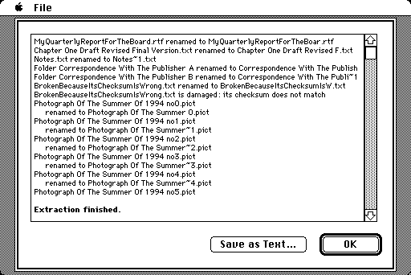

# MacExtract

**Open old Macintosh archives on the Macintosh they came from.**

A `.sit` from 1995 is easy to open on a modern computer and hard to open on
the Mac it was made for. MacExtract is one application that runs on
everything from a 1986 Mac Plus to Mac OS 9: no extensions, no installer.
A Linux command-line version is built from the same engine.

<table>
<tr>
<td width="50%"></td>
<td width="50%"></td>
</tr>
<tr>
<td></td>
<td></td>
</tr>
</table>

## Download

**[Latest release](https://github.com/uzTools/MacExtract/releases/latest)**,
currently **v0.41.0**, or from the tree:

| | |
|---|---|
| [`dist/MacExtract.bin`](dist/MacExtract.bin) | MacBinary, for any MacBinary-aware transfer |
| [`dist/MacExtract.dsk`](dist/MacExtract.dsk) | an 800K floppy image, for a real floppy or an emulator |
| [`dist/MacExtract-1440K.img`](dist/MacExtract-1440K.img) | the same at 1.44 MB, for a USB floppy drive and a SuperDrive Mac |

None of them needs an unarchiver to open. [`dist/README.txt`](dist/README.txt)
has the transfer notes.

## What it opens

StuffIt (classic and 5.x), Compact Pro, BinHex (and the older `.hex`/`.hcx`),
MacBinary, PackIt, AppleLink packages, DiskDoubler, Now Compress, StuffIt
SpaceSaver, Alysis SuperDisk!, Private File, ARC, LZH/LHA, uuencode, btoa,
base64 and MIME attachments, AppleSingle/AppleDouble, zip, gzip, tar and
`.Z`.

- **Everything comes back as it was:** both forks, type and creator, dates,
  icon positions, folder windows, Get Info comments, the Locked box and
  custom icons, so an extracted application simply runs.
- **Nested files** (`.sit.hqx`, `.tar.Z`) are unwrapped by looking inside,
  not by trusting the name. **Self-extracting archives** open as archives.
- **Passwords:** StuffIt, StuffIt 5, Compact Pro, PackIt, Private File, zip
  (including AES) and ARC. An encrypted StuffIt keeps half its key in the
  resource fork, so a copy that lost the fork cannot be opened by anything.
- **Split archives:** StuffIt, Compact Pro, DiskDoubler, spanned zip, `.001`
  splits and multi-part mail. Open the first part; you are asked for any
  that are elsewhere. Extract to a different disk from the parts.
- **Not opened:** StuffIt X, RAR, 7-Zip, bzip2, xz and other PC or modern
  formats. The Mac says *"Unknown format."*

## Compared with what Aladdin sold

**Expander 4.0.2** (1996) is the free StuffIt for System 6. **Deluxe 5.5.1**
(1999) is the last for 68k Macs and reads the most Mac formats of any
StuffIt. **Deluxe 7.0.3 Classic** (2003) is the last for Mac OS 9, and
PowerPC only.

| | Expander 4.0.2 (free, System 6) | Deluxe 5.5.1 (paid, last for 68k) | Deluxe 7.0.3 Classic (paid, last for Mac OS 9) | MacExtract |
|---|---|---|---|---|
| Oldest Mac it runs on | System 6.0.5 | System 7.1.1 (7.5.3 recommended), probably a 68020 | Mac OS 8.6, PowerPC, 32 MB | System 3.0, 68000, 512 KB |
| StuffIt, Compact Pro, BinHex, MacBinary | ✅ | ✅ | ✅ | ✅ |
| StuffIt 5 archives | 🔴 | ✅ | ✅ | ✅ |
| StuffIt X (`.sitx`) | 🔴 | 🔴 | ✅ | 🔴 |
| zip, gzip, tar, `.Z`, `.arc`, `.uu` | 🔴 | ✅ | ✅ | ✅ |
| zip's rare Reduce method, which no Mac program wrote | 🔴 | ✅ | 🔴 wrong bytes | ✅ |
| Type and creator in a zip made by MacZip | 🔴 * | 🔴 * | 🔴 * | ✅ |
| StuffIt SpaceSaver | 🔴 | ✅ | 🔴 | ✅ |
| PackIt (`.pit`) | 🔴 | ✅ | 🔴 | ✅ |
| AppleLink packages (`.pkg`) | 🔴 | ✅ | 🔴 | ✅ |
| `.lzh` / `.lha` | 🔴 | ✅ | ✅ | ✅ |
| DiskDoubler (`.dd`) | 🔴 | ✅ | 🔴 | ✅ |
| Now Compress and Alysis SuperDisk! | 🔴 | 🔴 | 🔴 | ✅ |
| RAR, ARJ and bzip2 | 🔴 | ✅ bzip2 only | ✅ | 🔴 |
| Private File (`.pf`) | 🔴 | ✅ | ✅ | ✅ |
| Self-mounting disk images | 🔴 | ✅ | ✅ | 🔴 |
| A Mac file mailed as a MIME attachment | 🔴 | ✅ | ✅ | ✅ |
| StuffIt sets split across floppies | 🔴 | ✅ | ✅ | ✅ |
| Compact Pro, zip or `.001` sets split across floppies | 🔴 | 🔴 | 🔴 | ✅ |
| An archive that arrived as several mail messages | BinHex postings only, not MIME | BinHex postings only, not MIME | 🔴 | ✅ |
| Encrypted StuffIt archives | ✅ | ✅ | ✅ | ✅ |
| Anything StuffIt Deluxe 2.0 itself wrote — its five Optimizers, all five of its ciphers | 🔴 one of the ten ** | 🔴 two of the ten | 🔴 none | ✅** |
| Encrypted Compact Pro archives | 🔴 | 🔴 | 🔴 | ✅ |
| The note somebody typed into an archive | ✅ | ✅ | ✅ | ✅ |
| What you install | an application and an extension | an installer, seven applications, the StuffIt Engine, Magic Menu and seventeen translators | an installer, twelve applications, CarbonLib and twenty-three format plug-ins | one application |
| Source | free, closed | paid, closed | paid, closed | free, open (LGPL) |

\* StuffIt discards the type and creator a MacZip archive stores, and guesses
from the name instead (seen with Expander 3.5.2; the three 🔴 are from
reading the programs' code).

\*\* Ten things StuffIt Deluxe 2.0 itself wrote: five Optimizers and five
ciphers, each checked against an archive 2.0.1 made.

**Speed**, both on the same 7 MHz Mac Plus, same archives, same disk:

| Archive | MacExtract | Expander 4.0.2 |
|---|---|---|
| A few KB of StuffIt | 3 s | 3 s |
| 280 KB StuffIt | 56 s | 56 s |
| 250 KB Compact Pro | **80 s** | 156 s |
| 300 KB BinHex with a StuffIt archive inside | **250 s** | 426 s |

The Deluxes do not run on a Mac Plus. Details in [FORMATS.md](FORMATS.md).

## What you need, and how long you will wait

- **Minimum:** System 3.0, 68000, 512 KB: a Macintosh 512Ke, or a Plus with
  its 1986 system. A true Macintosh 512K (64K ROM) starts it, but extracting
  needs HFS, which that machine has only with a Hard Disk 20; nobody has
  tried one yet. A Macintosh 128K is too small.
- **For everything:** 1 MB. In 512 KB some large StuffIt 5 archives, and a
  few other big ones, skip the entries that do not fit and extract the rest.
- **Runs on** System 6, System 7, Mac OS 8 and 9, PowerPC included.
- **Disk:** HFS, a floppy or a hard disk. MFS disks (most 400K floppies) are
  not supported.
- **Memory under System 7:** about 800 KB in Get Info is enough for every
  archive tested.

On a 1 MB Mac Plus, the slowest machine supported:

| Archive | Time |
|---|---|
| A few KB, any format | seconds |
| A few hundred KB, most formats | 1–2 minutes |
| 150 KB StuffIt 5 | 6 minutes |
| 200 KB StuffIt 5 unpacking to 640 KB, worst case measured | 12 minutes |

A faster Mac is proportionally faster.

## Linux

```sh
make
build/macextract l archive.sit           # list
build/macextract x archive.sit -o out    # extract
build/macextract x archive.sit -o out --only "Read Me"   # just that one
build/macextract sniff mystery.bin       # what is this?
build/macextract x secret.sit -p hunter2 # password-protected
```

## Is it any good?

It is checked byte for byte, both forks, against
[The Unarchiver](https://theunarchiver.com/) on over 900 real archives, and
the Mac application the same way while running on an emulated Mac Plus,
System 7 and Mac OS 9. Two real Macs have run it: an LC 475 under System
7.6.1 and an iMac under Mac OS 9.2.2. Nothing older has.

## Where things are written down

[FORMATS.md](FORMATS.md) (formats, memory, speed) ·
[TESTING.md](TESTING.md) (how it is verified) ·
[DECISIONS.md](DECISIONS.md) (why) ·
[OPEN_ITEMS.md](OPEN_ITEMS.md) (what is missing) ·
[BLOCKERS.md](BLOCKERS.md) (status) ·
[MANUAL_TESTS.md](MANUAL_TESTS.md) (what needs a real Mac)

## License

LGPL-2.1-or-later. Format details are transcribed from
[XADMaster](https://github.com/MacPaw/XADMaster); see `NOTICE`.

One exception, marked as one in `NOTICE`: `src/ss_dict.h` holds about 9.7 KB
that are **copyright Aladdin Systems, Inc.** — the tables SpaceSaver primes its
compression with, which its files cannot be decoded without. Carried for
interoperability, and not covered by the LGPL grant.
