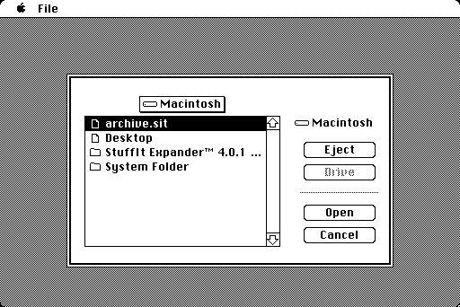
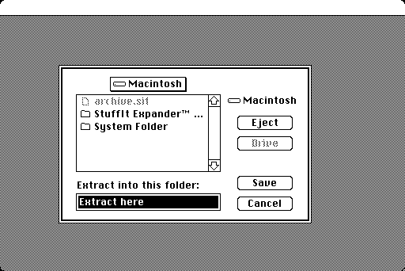
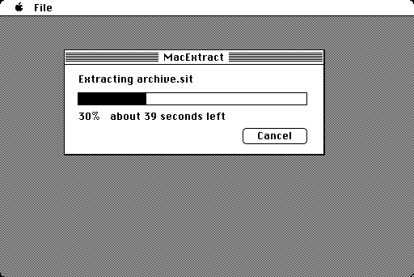
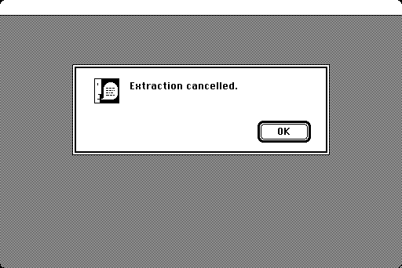
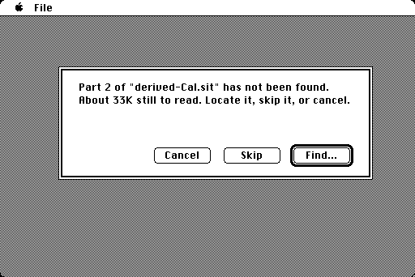

# unclassic

**Open old Macintosh archives — on the Macintosh they came from.**

A `.sit` file from 1995 is easy to open on a modern machine and surprisingly
hard to open on the machine it was made for. `unclassic` is an unarchiver for
Classic Mac OS that runs on everything from a 1986 Mac Plus with 1 MB of RAM
up to Mac OS 9 — one application, no extensions, no installer.

There is a Linux command-line version too, built from the same engine.

## What it looks like

Pick an archive:



Say where the files should go. This one opens in the archive's own folder, so
Return means "next to it", and any other disk is a Drive click away:



Watch it work — with a real estimate, because on a Mac Plus some archives take
half an hour:



Change your mind at any point, with the button or Cmd-. Anything half-written
is cleaned up:



Or let it finish:


If an archive was split across floppies and a part is not where the first one
was, you are asked for it — and told straight away if you point at the wrong
one, because parts are recognised by what is inside them:



## Download

**[Latest release](https://github.com/jarreboum/unclassic/releases/latest)** —
currently **v0.10.0**. If the release page shows anything older, the
publish step did not run and what is below is newer than what is there.
Or take it straight from the tree:

| | |
|---|---|
| [`dist/unclassic.bin`](dist/unclassic.bin) | the application as uncompressed MacBinary — transfer it with anything MacBinary-aware |
| [`dist/unclassic.dsk`](dist/unclassic.dsk) | an 800K HFS floppy image — write it to a real floppy, or mount it in Mini vMac, Basilisk II or SheepShaver |

Both hold the same application and neither needs an unarchiver to open, which
is the point: a bare Mac has no way to unpack a `.sit` until it already has
something that can. [`dist/README.txt`](dist/README.txt) has the transfer
notes.

## What it opens

**Extracts:** StuffIt (`.sit`, classic and 5.x), Compact Pro (`.cpt`),
BinHex (`.hqx`), MacBinary, PackIt (`.pit`), DiskDoubler (`.dd`, `DDAR`,
`DDA2`), Now Compress, Alysis SuperDisk! (`.X`), ARC (`.arc`), uuencoded
files (`.uu`), AppleSingle/AppleDouble, zip, gzip, tar, Unix compress
(`.Z`).

Nested files like `.sit.hqx` or `.tar.Z` are unwrapped automatically, by
looking inside them rather than trusting the name. A `.hqx` that holds
several files — one newsgroup posting, several attachments — gives you
all of them, not just the first — and so does a `.uu` file, which on top of
that carries the resource fork and the type when UUTool made it. A file that
was posted in several parts also works: join the parts and the mail headers
between them are stepped over. Resource
forks, type and creator codes and dates all survive, so an extracted
application simply runs.

**Recognises but does not extract:** StuffIt X, LZH, Disk Copy 4.2. It tells you what the file is rather than failing
obscurely.

**Archives split across floppies:** a StuffIt segmented set is joined back
together for you. Open the first part and the rest are found beside it; if a
part is somewhere else — another folder, another disk — you are asked to
point at it, and putting the disk in is enough: the part is picked up as soon
as the disk appears, with nothing to click. Parts are recognised by what is
inside them, so it does not matter what they are called or whether they are
all in one place. Send the
output to a different disk from the parts, which is the only thing that works
when the parts are on floppies you have to keep swapping.

The other ways an archive gets split are joined too, on the Macintosh
as well as on Linux: sets made by **Compact Pro** (open any segment —
they recognise each other by what is inside them), zip archives split
into `.z01`, `.z02` … `.zip`, and plain `.001`/`.002` splits. For those
last two the names are the only thing that says which parts belong
together, so keep them.

Sets whose parts are each still in their own BinHex or MacBinary wrapper
(`Archive.sit.1.hqx`, `Archive.sit.2.hqx`) — which is how these were
usually downloaded — are joined as well: open the first part and the
rest are found inside their wrappers. It does not mind if only some of
them still are.

Encrypted archives are out of scope.

## Compared with StuffIt Expander 4.0.2

Expander is what you would otherwise reach for on the machine itself. It is
free, it was the standard, and on System 7 it is nicer to use. Here is what
each one opens:

| | StuffIt Expander 4.0.2 | unclassic |
|---|---|---|
| StuffIt, Compact Pro, BinHex, MacBinary | yes | yes |
| StuffIt 5 archives | no — needs Expander 5 or later | yes |
| zip, gzip, tar, `.Z` | only with a paid add-on, System 7 only | yes |
| PackIt (`.pit`) | not listed | yes |
| Sets split across floppies | StuffIt sets, with the same add-on | StuffIt, Compact Pro, zip and `.001` sets |
| Split zip or Compact Pro sets | "cannot expand" — its own Read Me | yes |
| Encrypted archives | yes, if you know the password | no |
| Several files posted in one BinHex message | yes | yes |
| `.arc` and uuencoded (`.uu`) files | with the add-on | yes |
| AppleLink `.pkg`, StuffIt SpaceSaver | with the add-on | no — nobody has published how either one is laid out, and this project does not guess |
| DiskDoubler, Now Compress and SuperDisk! archives | no | yes |
| What you install | the application, a StuffIt Engine extension, and the add-on for anything above | one application |
| Source | free, closed | free, open (LGPL) |

Under System 7 Expander also has drag-and-drop, watch folders and background
expansion; under System 6 both are menu-driven. The full table, with sources,
is in [FORMATS.md](FORMATS.md) under "Compared with StuffIt Expander 4.0.2".

## What you need

| | |
|---|---|
| Minimum | System 6.0.8, 68000, **1 MB of RAM** |
| Also runs on | System 7, Mac OS 8 and 9, PowerPC via the built-in 68k emulator |
| Disk | one 800K floppy |

The same binary adapts to whatever machine it finds itself on, so the download
above is the only one. (`tools/make_dist.sh` rebuilds it from source.)

## How long it takes

On a 1 MB Mac Plus, the slowest machine supported:

| Archive | Time |
|---|---|
| A few KB, any format | seconds |
| 300 KB StuffIt or BinHex | 2–3 minutes |
| 200 KB StuffIt 5 | 16 minutes |
| 200 KB StuffIt 5, worst case measured | 32 minutes |

StuffIt 5 is in a class of its own — its compression was designed for machines
a decade newer. Everything else is quick, and a faster Mac is proportionally
faster.

## Linux

```sh
make
build/unclassic l archive.sit           # list
build/unclassic x archive.sit -o out    # extract
build/unclassic sniff mystery.bin       # what is this?
```

## Is it any good?

It is checked against [The Unarchiver](https://theunarchiver.com/) on 804 real
archives, byte for byte, both forks. The Macintosh application is checked the
same way *while running on* an emulated Mac Plus, a System 7 machine and a
Mac OS 9 PowerPC — not only on Linux.

No physical Macintosh has ever run it. Emulation is evidence, not proof.

## Where things are written down

| | |
|---|---|
| [FORMATS.md](FORMATS.md) | every format: support, memory, speed |
| [TESTING.md](TESTING.md) | how it is verified |
| [DECISIONS.md](DECISIONS.md) | why it is built the way it is |
| [OPEN_ITEMS.md](OPEN_ITEMS.md) | what is missing |
| [BLOCKERS.md](BLOCKERS.md) | current status, and claims since disproved |
| [MANUAL_TESTS.md](MANUAL_TESTS.md) | what still needs a real Macintosh |

## License

LGPL-2.1-or-later. Format details are transcribed from
[XADMaster](https://github.com/MacPaw/XADMaster); see `NOTICE`.
